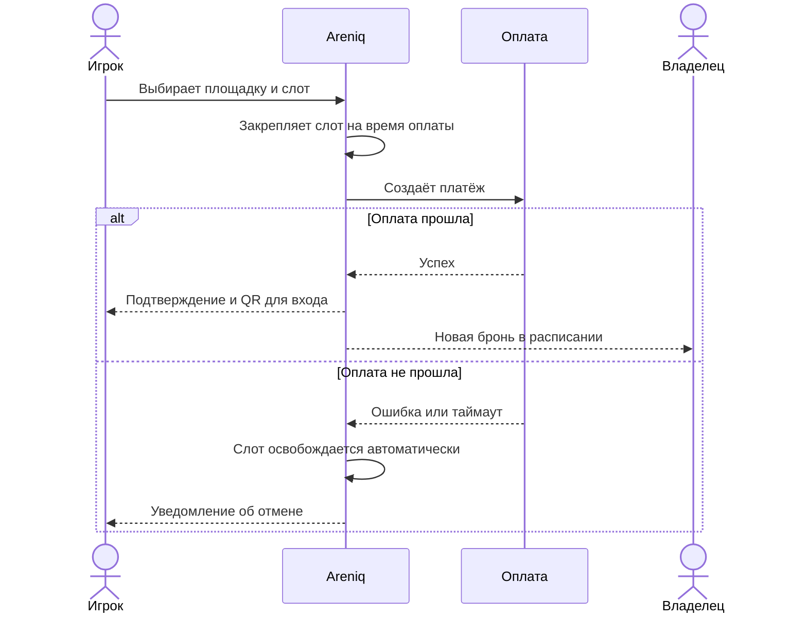

# Areniq

A minimal full-stack application scaffold with a React and TypeScript frontend, a Go API, and Docker Compose.


# Areniq

**Аренда спортивных площадок без звонков и переписок**

Найди площадку на карте, выбери слот, оплати онлайн и получи QR для входа.


[Описание](#-краткое-описание) •
[Проблема](#-проблема) •
[Решение](#-решение) •
[Возможности](#-возможности) •
[Как это работает](#-как-это-работает) •
[Монетизация](#-монетизация) •
[Roadmap](#-roadmap)

</div>

## Requirements

- Node.js 20 or later
- Go 1.24 or later
- Docker with the Compose plugin (optional)

## Run locally

Start the API in one terminal:

```sh
cd backend
go run .
```

Start the frontend in another terminal:

```sh
cd frontend
npm install
npm run dev
```

Open <http://localhost:5173>. The Vite development server proxies `/api` requests to the Go service at `http://localhost:8080`.

## Run with Docker

From the repository root:

```sh
docker compose up --build
```

Open <http://localhost:8080>. The frontend container serves the application and proxies API requests to the backend container. Stop the services with `Ctrl+C` or `docker compose down`.

## API

- `GET /api/health` returns `{"status":"ok"}`.

Run the backend tests with `cd backend && go test ./...`.

## Project layout

```text
backend/      Go HTTP API and tests
frontend/     React + TypeScript application
docker/       Nginx configuration for the frontend container
compose.yaml  Local multi-container setup
```
<div align="center">

---

## 📌 Краткое описание

Areniq это сервис аренды спортивных площадок. Игрок находит свободную площадку на карте, выбирает слот, оплачивает онлайн и получает QR для входа. Владелец управляет расписанием и ценами, а в дашборде видит загрузку, выручку и отмены.

Слоты обновляются в реальном времени, бронь защищена от двойной записи.

## 🔥 Проблема

**Для игроков**

- приходится обзванивать администраторов и писать в чаты и мессенджеры
- информация о свободных слотах часто устарела
- бронь через звонок или переписку не подтверждается автоматически
- из-за этого случаются двойные записи и отмены в последний момент

**Для владельцев площадок**

- расписание ведётся в тетрадях или таблицах
- нет реальной картины загрузки по часам
- деньги теряются на пустых слотах и несвоевременной оплате

Нет единого места, где можно сразу увидеть свободное время, оплатить и получить подтверждение.

## 💡 Решение

Areniq собирает всё в одном месте.

**Игрок**

- находит площадку на карте
- видит свободные слоты в реальном времени
- оплачивает бронь онлайн
- получает QR-код для входа

На время оплаты слот закрепляется за игроком, поэтому двойных броней не бывает, а при неудачной оплате он сам освобождается. Если нужный слот занят, можно встать в очередь и получить уведомление в Telegram, когда он освободится.

**Владелец площадки**

- расписание и цены
- ручные брони
- выплаты
- дашборд с загрузкой по часам, выручкой и отменами

Это помогает заполнять пустые слоты и подбирать цены под спрос.

## ✨ Возможности

| Для игрока                                        | Для владельца                                  |
| ------------------------------------------------- | ---------------------------------------------- |
| 🗺️ Поиск площадок на карте                        | 📅 Управление расписанием                      |
| ⚡ Свободные слоты в реальном времени             | 💰 Гибкая настройка цен                        |
| 💳 Онлайн-оплата брони                            | ✍️ Ручные брони                                |
| 📲 QR-код для входа                               | 💸 Выплаты                                     |
| 🔒 Закрепление слота на время оплаты              | 📊 Дашборд: загрузка по часам, выручка, отмены |
| ⏳ Очередь на занятый слот                        | 🧠 Подбор цен под спрос                        |
| 🔔 Уведомление в Telegram об освободившемся слоте | 📈 Расширенная аналитика по подписке           |

## ⚙️ Как это работает



**Защита от двойных броней.** Пока игрок оплачивает, слот закреплён за ним и недоступен остальным. Если оплата не прошла, слот сам возвращается в свободные.

**Очередь на слот.** Если слот занят, игрок встаёт в очередь. Когда слот освобождается, приходит уведомление в Telegram.

## 💼 Монетизация

- **Комиссия** с каждой брони
- **Подписка для владельцев** с расширенной аналитикой

## 🗺️ Roadmap

- [x] Идея и описание продукта
- [ ] Карта площадок и поиск
- [ ] Слоты в реальном времени
- [ ] Бронирование с защитой от двойной записи
- [ ] Онлайн-оплата
- [ ] QR-код для входа
- [ ] Очередь на занятый слот и уведомления в Telegram
- [ ] Личный кабинет владельца: расписание, цены, ручные брони
- [ ] Дашборд: загрузка, выручка, отмены
- [ ] Выплаты владельцам
- [ ] Подписка с расширенной аналитикой

---

<div align="center">

Сделано для тех, кто хочет играть, а не обзванивать администраторов 🏀⚽🎾

</div>
